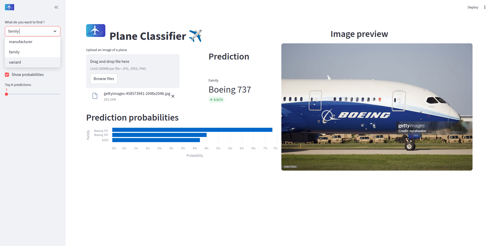
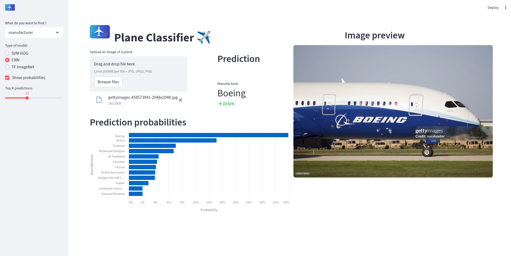

# Description
This project is meant to classify plane from pictures.
It use three models, Neural networks, SVM and ImageNet by transfer learning.

Cause of the size, models published for the tests are reduced by performance.

# How to run the project
The dependencies of the project is handle with [pipenv](https://pipenv.pypa.io/en/latest/installation.html)

- clone the project
- According to what you would like to do, you'll find the command in the make file. 

## Publication 
A first version is published here, and for the same reason it not yet take into account the models object. But you can clone the model and try it locally. 
The published version is available [here](https://share.streamlit.io/rich229/plane-classification/main/app/app.py)

# References:
More information on the images [here ](https://www.robots.ox.ac.uk/~vgg/data/fgvc-aircraft/)
